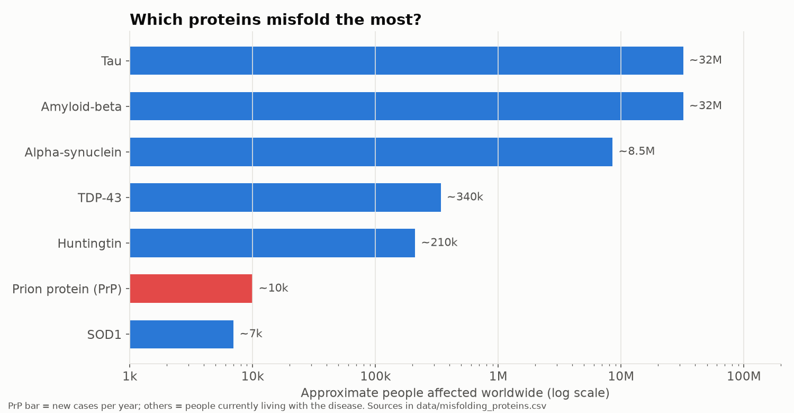
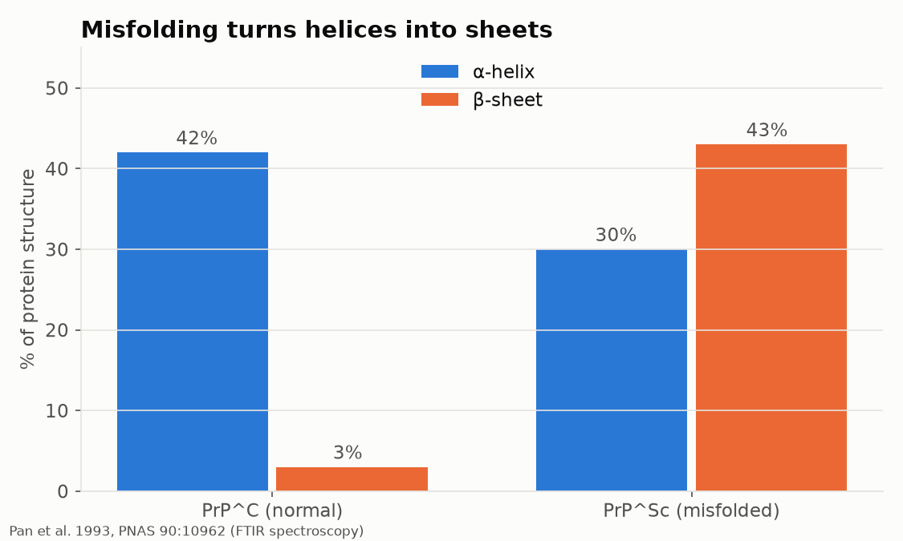
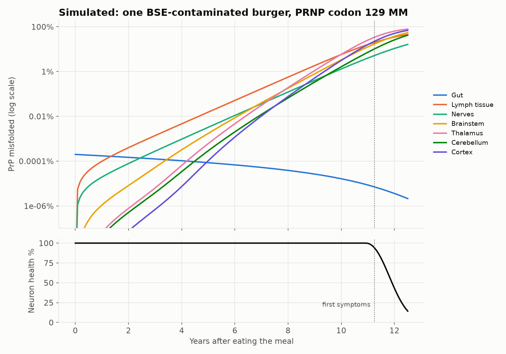
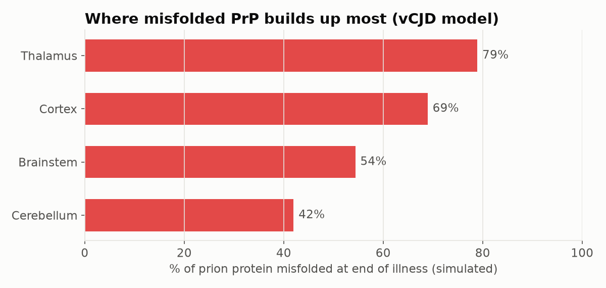
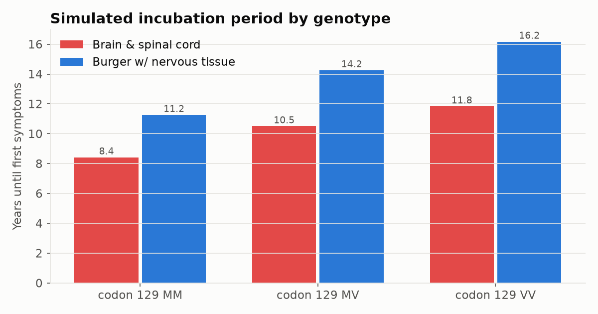
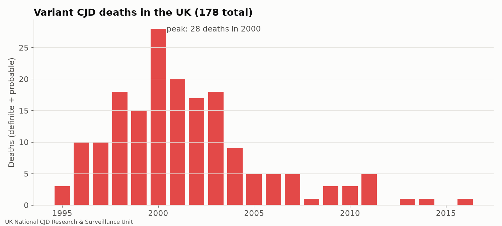

# Prion Disease Simulator

**Choose a meal and watch your own proteins misfold.**

An interactive website about prion diseases: mad cow disease (BSE), variant Creutzfeldt-Jakob disease (vCJD), chronic wasting disease and scrapie. Pick something to eat and the simulator follows the misfolded prion protein from your gut, through your lymph tissue and nerves, into your brain. You can zoom in from brain tissue down to single molecules and watch healthy proteins get refolded.

**Live site:** https://knives3337.github.io/prion-disease-simulator/

## Features

| | |
|---|---|
| **Meal picker** | Salad, tofu, healthy steak, BSE-infected beef (muscle, burger, brain), CWD venison, scrapie lamb |
| **Genetics** | PRNP codon 129 genotype (MM / MV / VV) changes how fast the disease takes hold |
| **Body map** | Gut → Peyer's patches → tonsils/spleen → vagus nerve → brainstem → thalamus, cerebellum, cortex |
| **Microscope** | Three magnifications: **Molecules** (α-helix proteins turning into β-sheet clumps), **Brain tissue** (H&E-style section that turns spongy, with florid plaques and neuron loss), **Single protein** (one PrP docking onto a fibril and refolding) |
| **Timeline** | Play, pause and scrub through decades; the story panel explains each stage and its symptoms |
| **Graphs** | Live misfolding per body region (log scale), neuron health, which proteins misfold the most, where PrP builds up, helix → sheet structure change, UK vCJD deaths |

Shareable links: `index.html#food=bse_brain&genotype=MV&meals=5&t=120&view=tissue&region=cortex`

## Graphs

All generated by [`analysis/make_graphs.py`](analysis/make_graphs.py) from the CSVs in [`data/`](data/).

### Which proteins misfold the most?


Amyloid-β and tau (Alzheimer's) misfold in far more people than any other protein. The prion protein is rare, but it is the only one shown to spread between individuals and species, including by eating.

### Misfolding turns helices into sheets


### Simulated spread after one contaminated meal


On a log scale you can see the silent decade: the amount of misfolded protein grows roughly 10× every year while the person feels nothing.

### Where misfolded PrP builds up most (simulated)


### Incubation by genotype (simulated)


### Variant CJD deaths in the UK


## The model

A compartment model in [`js/model.js`](js/model.js), with an identical Python port in [`analysis/model.py`](analysis/model.py). For each body region *i*, `S_i` is the fraction of prion protein that is misfolded:

```
dS_i/dt = m·r_i·S_i(1−S_i)·S_i/(S_i+Kn)      templated conversion (with a nucleation threshold)
        + Σ k_ji·(m/m_ref)·S_j·(1−S_i)        seeds spreading from upstream regions
        − c_i·S_i                             clearance by the body

dH/dt   = −k_d·max(0, S_brain − θ)·H          neuron loss once the brain load is toxic

m = species barrier × codon-129 genotype factor
```

* **Nucleation threshold:** tiny doses are cleared before they can start a chain reaction, so one bite of BSE muscle usually does nothing but a hundred meals might.
* **Species barrier:** CWD and scrapie prions template human PrP poorly, so the infection fizzles out. No human cases of either have been confirmed.
* **Calibration:** constants are tuned so the classic vCJD case (contaminated beef, genotype MM) gives about 11 years of incubation and about 15 months of illness, in line with published estimates. They aren't measured biochemical rates.

Run it from the command line:

```bash
python3 analysis/model.py         # table of onset/death/clearance for every food × genotype
python3 analysis/make_graphs.py   # regenerate graphs/*.png (needs matplotlib)
```

## Running locally

It's a static site with no build step and no dependencies.

```bash
python3 -m http.server 8000
# open http://localhost:8000
```

## Project structure

```
index.html            page layout
css/style.css         styles (light + dark mode)
js/data.js            foods, regions, reference data
js/model.js           the disease model
js/microscope.js      canvas: molecules, tissue, single-protein views
js/bodymap.js         SVG body map
js/charts.js          small SVG chart library
js/app.js             wiring, timeline, story text
analysis/             Python model + graph generator
data/                 CSV reference data with sources
graphs/               generated PNG graphs
```

## Sources

* Pan K-M et al. (1993) *Conversion of α-helices into β-sheets features in the formation of the scrapie prion proteins.* PNAS 90:10962
* UK National CJD Research & Surveillance Unit, vCJD statistics: https://www.cjd.ed.ac.uk
* Gustavsson A et al. (2023) *Global estimates on the number of persons across the Alzheimer's disease continuum.* Alzheimer's & Dementia 19:658
* WHO Parkinson disease fact sheet (2023)
* Further sources for each number are in [`data/misfolding_proteins.csv`](data/misfolding_proteins.csv)

## Disclaimer

This is an educational simulation, not medical advice. Beef sold today is very safe: feed bans and removal of brain and spinal cord from the food chain ended the BSE epidemic.

## License

MIT
